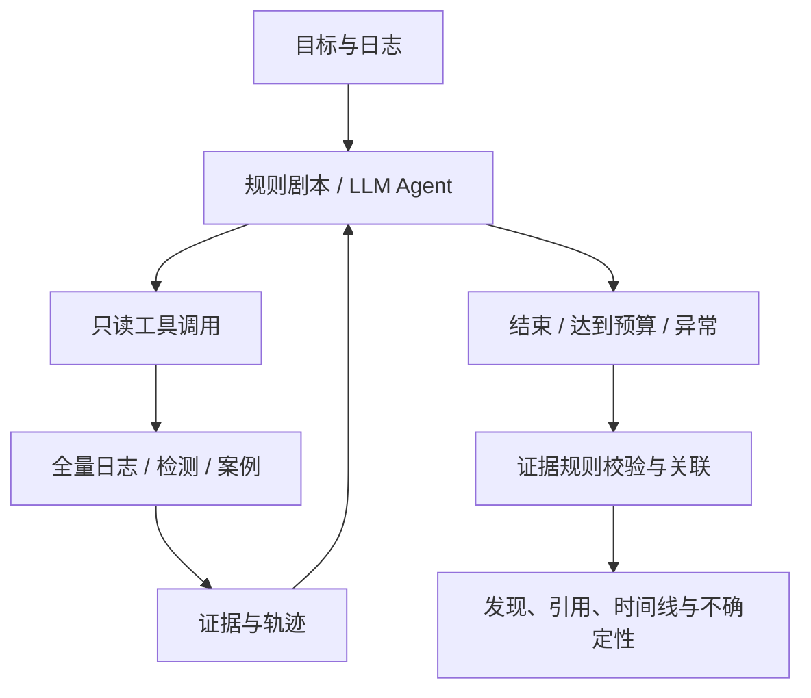

# LogFusion-Agent

**证据驱动的安全日志调查智能体**

基于 [LogFusion-LLM / public-upload](https://github.com/kingofbuilding/LogFusion-LLM/tree/public-upload) 演进，增加调查工具调用、事件关联、证据时间线和可追溯报告。原项目的多视图检测、融合和 RAG 源码保留；固定来源见 [UPSTREAM.md](UPSTREAM.md)。

第一版聚焦：**SSH 集中认证失败 → 同来源、同账号、同主机的后续成功登录 → 账户活动核查**。

## 两种运行方式

| 方式 | 如何决定下一步 | 条件 |
| --- | --- | --- |
| 规则调查演示 | 根据前序结果执行 SSH 剧本；无失败簇时跳过后续登录查询 | Python 3.10+，CLI 仅需标准库 |
| LLM Agent | 模型观察工具结果，每轮选择工具；结束后由 Agent 调用综合研判 | 支持工具调用的模型及本地密钥 |
| 完整链路模拟演示 | 真实日志查询与案例检索，综合研判阶段使用模拟模型 | 无需密钥，不代表真实 LLM 效果 |

规则剧本不等于 LLM 自主规划。两者使用同一证据层：规则发现按显式关联规则生成；LLM 模式另外调用模型综合已查日志与参考案例，输出带引用的辅助研判。

## 快速体验

```bash
git clone https://github.com/kingofbuilding/LogFusion-Agent.git
cd LogFusion-Agent
python -m src.agent --demo
# 查看含综合研判、建议和引用的完整模拟链路：
python -m src.agent --demo --mode simulated
```

无需密钥或权重。结果位于 `outputs/investigations/INV-*/`，包含 `report.md` 与完整的 `investigation.json`。演示是合成日志，IP 使用文档保留地址，包含不同账号、主机和时间的干扰事件。

```bash
pip install -r requirements-agent.txt
streamlit run frontend/agent_app.py
```

工作台默认进入明确标注的完整模拟演示。页面支持综合研判、规则发现、证据时间线、工具轨迹四个页签，以及 Markdown/JSON 下载。可展开每条判断查看原始日志与参考案例。

## 使用 LLM Agent

复制 `.env.example` 为 `.env`，配置支持工具调用的服务：

```dotenv
AGENT_API_KEY=your_actual_key
AGENT_BASE_URL=https://api.deepseek.com
AGENT_MODEL=deepseek-chat
```

```bash
python -m src.agent --demo --mode llm
# 也可使用固定规则调查，只在综合研判阶段调用真实模型：
python -m src.agent --demo --llm-judge
python -m src.agent --input path/to/auth.jsonl --mode llm --goal "调查 SSH 暴力破解和后续登录"
```

也可使用 `DEEPSEEK_API_KEY` 或 `OPENAI_API_KEY` 及对应 Base URL。不要在实际 `.env` 中保留模板占位符。LLM 模式向配置的服务发送目标及部分日志；规则模式不外发日志。

## 六个只读工具

| 工具 | 能力 |
| --- | --- |
| `detect_anomalies` | 返回规则候选信号，或调用原项目检测模型 |
| `aggregate_events` | 按时间窗口、IP、账号、主机聚合认证失败 |
| `search_logs` | 查询完整日志，包括低风险的成功登录 |
| `get_event_context` | 查询已观察事件前后同账号、同主机活动 |
| `retrieve_cases` | 检索解释性案例，与事件事实分离 |
| `build_timeline` | 汇总已查询证据，保留来源、行号和事件 ID |



## 输入与关联规则

支持 UTF-8 的 `.log`、`.txt`、`.jsonl`、`.json` 对象数组和 `.csv`。结构化输入需有 `message` / `log_text` / `raw` / `content`，可提供 `timestamp`、`host`、`src_ip`、`user`。

```json
{"timestamp":"2026-01-15T10:00:00Z","host":"server-a","message":"sshd[1]: Failed password for alice from 198.51.100.23 port 51000 ssh2"}
```

- 支持常见 SSH/sudo syslog；完整年份 ISO 时间参与关联。无时区按 UTC；年不完整时不猜测年份。
- 同 IP、账号、主机 5 分钟内至少 5 次失败，标为疑似暴力破解；关联失败簇结束后 15 分钟内成功登录，再查后续 15 分钟账户上下文。
- 每个实体仅检查最密集失败窗口；规则剧本最多调查 3 组、深入查询 3 条成功登录。截断会披露。
- 最大 20 MiB / 100000 条；单条最多 32768 字符。
- 未允许字段（包括攻击标签与人工结论）不进入工具；原始 message 若包含答案或敏感信息，导入前仍需处理。

## 复用原检测与 RAG

训练和建索引方式见 [原项目说明](docs/UPSTREAM_README.md)。

```bash
pip install -r requirements.txt
# 按原说明准备数据、训练模型并构建案例索引后：
python -m src.agent --input path/to/auth.jsonl --with-detector --vector-rag
streamlit run frontend/app.py
```

原界面新增默认的 Agent 调查入口。公开仓库不含权重和私有日志。默认后端明确标记 `rule_signals` 和 `lexical_case_search`，不伪称训练模型或向量 RAG。显式启用模型/索引但文件缺失时会报错。

本地已有训练产物时，可从上游工程 `log_analysis_system_complete` 复制以下文件启用真实模型与向量索引：

```text
models/xgboost/xgboost_fusion.joblib
models/isolation_forest/iforest_model.joblib
models/bilstm/best_model.pth
data/vectors/rag_attack_cases.npz
```

启用后 `detect_anomalies` 返回 `upstream_three_view_xgboost` 的真实窗口分数。注意两点：其一，窗口分数按末行事件 ID 定位，整窗证据需由调用方展开，否则标注事件可能永远落在窗口内部而不可见；其二，迁移过来的向量索引以哈希回退嵌入构建（本机未装 sentence-transformers），与查询的最高余弦相似度约 0.14，低于阈值 0.65/0.7，因此 `retrieve_cases` 在该索引下实际返回空，D 组差异来自检测器而非语义检索。

原检测器的窗口分数映射到末行事件 ID。各视图仍遵循上游代理分数与 hash 回退逻辑；融合模型存在不代表所有视图模型已训练加载。

## Agent 循环与收尾

每一轮只做一件事：观察已有工具结果 → 选择下一个工具 → 执行 → 把结果写回轨迹。循环由预算控制，收尾由 Agent 自己完成，不依赖外部脚本：

| 阶段 | 预算 | 行为 |
|---|---|---|
| 工具阶段 | `max_steps - 2` 步、token 的 2/3 | 自主选择工具；重复调用只回灌提示，不中止调查 |
| 收尾模式 | token 用到 75% 或只差 2 步时进入 | 追加“停止探索”指令，工具只剩 `build_timeline` / `retrieve_cases` / `finish_investigation` |
| 收尾阶段 | 保留 ≥2 步、≥1/3 token | 补查案例、调用综合研判、生成报告 |

状态取值：

| 状态 | 含义 |
|---|---|
| `completed` | 正常结束，证据与研判都产出 |
| `completed_partial` | 收尾模式或降级收尾结束；报告完整，但调查未覆盖全部路径 |
| `limited` | 连收尾预算都不够（如总量过小），不发布研判 |
| `cancelled` / `error` | 用户取消 / 规划器或服务异常 |

三种常见的“快失败”都会降级为“带披露地完成”，而不是直接终止：

- 工具预算用尽 → `evidence_budget`：停止取证，用已查证据完成研判，限制里写明“提前收束”；
- 连续工具错误 → 同样收束，不把整次调查判为失败；
- 研判连续两次未通过校验 → `judgment_rejected`：只发布规则发现与证据，限制里注明研判未发布。

报告始终包含发现、证据时间线、引用与不确定性；`stop_reason` 记录真实的结束原因，不把降级结果标成完全成功。

## 预算与边界

```bash
python -m src.agent --demo --max-steps 16 --max-seconds 90 --max-tokens 24000
```

- 设轮数、累计 token、重复调用、工具错误限制，记录停止原因。
- 时间/token 在调用之间及模型返回后检查；在途调用可能超限，因此不是严格费用上限。单次输出上限 1200 tokens，网络默认超时 20 秒，无自动重试。
- 模型每次最多查看 20 条事件预览，每条原文 600 字符；完整已查证据保留在 JSON。
- 支持结果保存，尚无进程重启后的恢复；同步 UI 暂无取消按钮。
- 没有自动封禁、Shell 或主机操作能力。上传文本作为不可信数据；工具白名单与证据规则不代表所有提示注入都已彻底解决。
- 成功登录不等于入侵成功，sudo 不等于恶意提权，未发现后续活动不等于证明安全。

## 验证

```bash
pip install -r requirements-dev.txt
python -m pytest -q
python -m src.agent --demo
```

覆盖实体误关联、时间窗口、完整流查询、引用、标签隔离、预算、模型工具调度与导出。LLM 自动测试使用模拟服务，覆盖规划→检索→综合研判整条链路、引用错误修正与拒绝。

## 事件级评测

```bash
python -m benchmarks.generate_cases                       # 42 条标注 SSH 用例，固定种子
python -m benchmarks.run_eval                              # B 组：规则剧本，离线、零 token
python -m benchmarks.run_eval --groups rule,simulated       # 加模拟研判全链路
python -m benchmarks.run_eval --groups upstream             # A 组：上游检测器一次性出证据
python -m benchmarks.run_eval --groups agent+upstream --limit 20   # D 组：Agent + 检测器 + 向量 RAG
python -m benchmarks.run_eval --groups llm --repeats 3 --limit 20  # C 组：纯 LLM 调查
```

评测集覆盖 7 类关联/干扰场景，标签只写入 `<case>.json`，工具只能读到 `<case>.jsonl`。指标为结论正确率、关键证据召回、证据精度、误关联、步数、token、完成率与工具报错率；证据精度用于暴露“窗口级证据”召回高但精度低的问题。首版结果与已知限制见 [评测报告](docs/EVAL_REPORT.md)；注意标注规则与证据层同源，结论正确率衡量的是管线一致性而非真实入侵检测能力。

实施过程中遇到并处理的工程问题（工具参数越界、窗口证据映射、哈希索引不可用、并行改动冲突等）记录在 [工程问题记录](docs/ENGINEERING_ISSUES.md)。

## 许可证

MIT，保留原项目许可。来源见 [UPSTREAM.md](UPSTREAM.md)。

默认 Agent 案例库位于 `data/agent/reference_cases.jsonl`，只使用上游内置通用案例，不使用从带标签实验日志抽取的模板。可选原向量 RAG 仍应自行审核其案例来源，避免评测泄漏。

## 综合研判与引用检查

Agent 完成调查后，若尚未成功检索案例，会先补查案例。随后调用 `synthesize_judgment`，将已查日志、规则发现、案例和覆盖范围送给研判模型。

输出包含：

- `assessment`：可疑、需人工复核或证据不足，不提供自动“确认入侵”判决。
- `claims`：分离观察与推断；每条必须引用实际发送给研判模型的日志 ID，案例 ID 独立记录。
- `recommendations`：建议及依据，不自动执行。
- `uncertainties`：缺失证据、替代解释与待确认问题。

校验结构、日志 ID 和案例 ID。无效引用触发最多一次修正，仍失败则不发布 LLM 内容，保留规则发现和证据。**引用有效不代表文字必然符合证据，尚未实现自然语言语义真实性验证。**

综合研判最多接收 60 条证据，每条原文最多 1000 字符，以及 10 个案例；原始证据完整保留。研判及修正纳入同一轮数、时间和累计 token 预算；在途请求仍可能越过软预算。

`--mode simulated` 的查询、检索、结构化输出与引用校验真实执行，但模型回复在本地确定性模拟，token 为 0，不访问外部服务。页面与导出报告均标明模拟来源。
